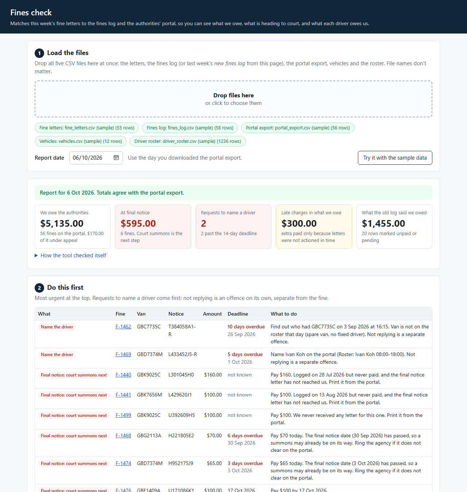

# Fines check

A weekly check for the fleet admin. It matches the fine letters, the fines log and the authorities' portal export, and answers three questions:

- **What do we owe, and is anything heading to court?** (for the manager)
- **Who was driving, and what does each driver owe us?** (for finance and payroll)
- **What do I actually need to do this week?** (for the admin)



## Run it


1. Download this folder (or the zip) and unzip it.
2. Open `prototype/index.html` by double-clicking it. It opens in Edge or Chrome.
3. Click **Try it with the sample data**, or drag in your own five CSV files.

To skip step 3, open `prototype/index.html?sample` and the sample data loads automatically.

The person who will use it each week has her own guide: [`submission/03_user_guide.md`](submission/03_user_guide.md).

## What it does

The core idea is that **a fine is an offence, not a letter**. One offence can generate a notice, a reminder (with a new notice number and +$15), a request to name the driver, and a final notice (+$30). The tool groups every letter, log row and portal row under the one offence it belongs to, and works everything out from that.

| Question | Where the answer comes from |
|---|---|
| What we owe | The portal export only. If the portal lists it, we owe it. If it doesn't, we don't. Letters and the log are supporting evidence. |
| Same fine or a new one? | Notice number first. If that fails, the same van, offence date, offence time and offence type. The +$15/+$30 pattern then confirms the stage. |
| Who was driving | The roster, but only when exactly one shift covers a trustworthy offence time. Shift handovers, after-hours offences, Sundays, the spare van, the workshop and unreliable log times all go to the admin instead of being guessed. |
| Who pays | The driver on shift pays the **original** fine. The company pays the late charges, because those come from our delay, not from the driving. |
| What's been recovered | Only rows marked Deducted count. A fine only goes on the payroll list once **we** have paid it. |

Each run produces three downloads:

- **New fines log (CSV).** The admin's old log with the same columns, cleaned up, with one row per offence and a few columns added. She loads it next week instead of the old log, so decisions she makes carry forward.
- **Payroll deduction list (CSV).** Per driver, with how each driver was identified.
- **Action list (CSV).** What to pay or answer, in order of urgency.

## Results on the sample data (report date 6 Oct 2026)

- **$5,135 owed across 56 fines, matching the portal to the cent.** The old log said $1,455.
- **Six fines at final notice ($595).** Two of them were in the log, marked unpaid, since July and August. One never arrived as a letter at all.
- **Two requests to name a driver, both past the 14-day deadline.** One is easy (Ivan Koh). The other is a speeding offence on the spare van on a day nobody was rostered to it.
- **Three "paid online 28 Sep" fines are still on the portal.** F-1450 is flagged as a reminder that was typed in as a new fine.
- **4 of the 15 drivers named in the old log don't match the roster.** None of them is charged until someone confirms.
- **$105 confirmed recovered from drivers.** $1,845 is ready for payroll, $3,390 is due once we pay, and $1,460 can't be charged to anyone until the driver is confirmed.

## Folder layout

```
prototype/
  index.html        the page
  app.js            page wiring only (loading files, drawing tables, downloads)
  fines-core.js     all the matching and money logic; no page code, so it is testable
  sample-data.js    the five sample CSVs bundled for the sample button (generated)
tests/core.test.js  33 tests: parsing rules, known answers on the sample, re-use in month two
tools/build-sample.js  rebuilds sample-data.js from the CSVs in the root
analysis/           the scripts I used to explore the data before building anything
submission/         the written deliverables
*.csv               the sample data as provided
```

## Tests (optional, for whoever maintains it)

Needs Node.js 18 or newer. No packages to install.

```
node --test tests/core.test.js
```

The "known answer" tests were written from my own hand analysis of the CSVs before the tool existed. To make sure they can actually fail, I broke two rules on purpose: treating log times as local instead of UTC fails 5 tests, and changing the reminder increase from $15 to $20 fails 3.

If you change the sample CSVs, run `node tools/build-sample.js` so the sample button matches.

## Business rules you may want to change

All of these are in `POLICY` at the top of `prototype/fines-core.js`:

- **UTC offset (8 hours).** The log's times end in "Z".
- **Reminder and final notice increases (+$15 and +$30).** These are taken from the sample data. Confirm them with the agencies.
- **Driver-request deadline (14 days from receipt).** The tool uses whichever is earlier: that, or the date on the letter.
- **"Due soon" window (7 days) and portal catch-up time (7 days).**
- **Agency by notice-number prefix:** H = HDB, L = LTA, U = URA, T = TP.

The liability rule (driver pays the original, company pays late charges and workshop fines) is in `derive()`. It is written out in plain terms so that HR or finance can check it.

## Further reading

- [Problem statement and questions](submission/01_problem_and_questions.md)
- [How this would be wrong](submission/02_how_this_would_be_wrong.md)
- [One-page guide for the fleet admin](submission/03_user_guide.md)
